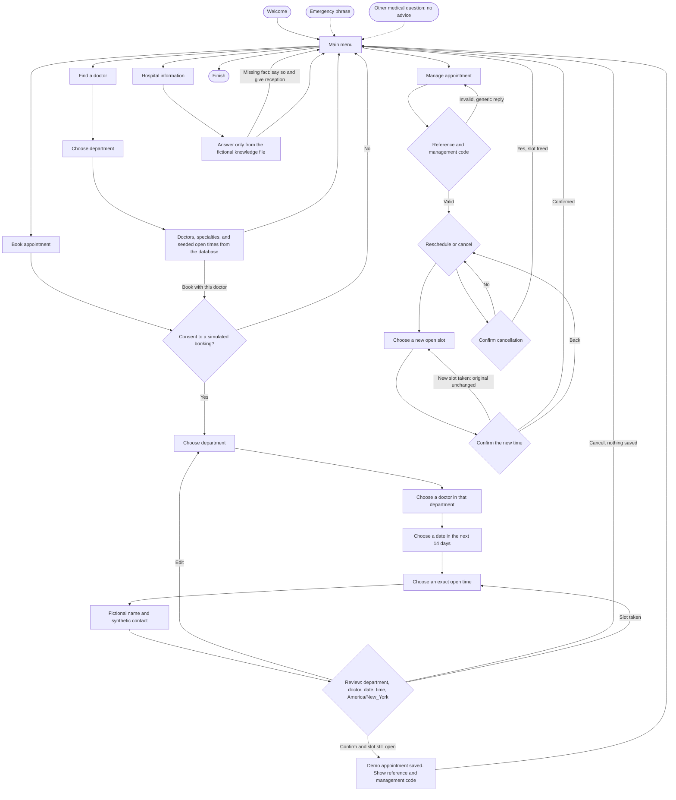

# DocBooker flow map

This diagram is a plan for the Botpress workflows and for the Flask state machine. It is not a screenshot of a published bot.

Emergency phrases interrupt every flow, including an in-progress booking, and return to the menu. The review nodes are gates: Confirm is the only path that writes a booking, and the cancel gate is the only path that frees a slot.
